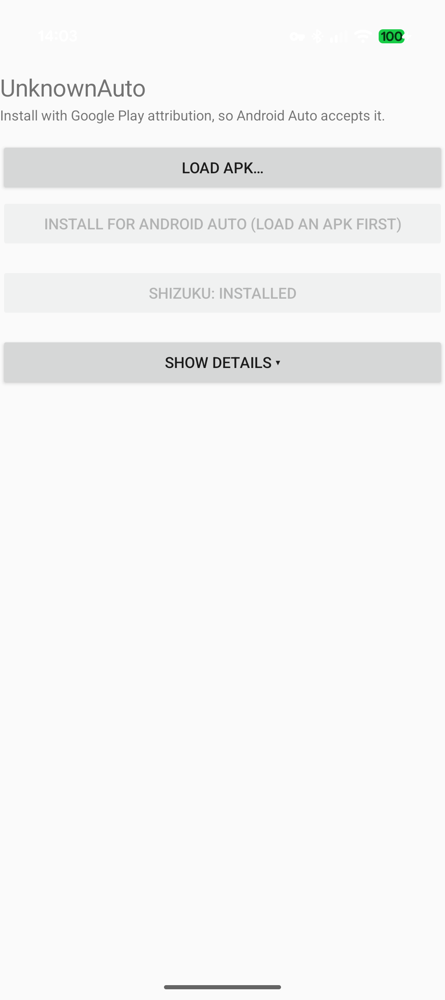

# UnknownAuto

[](https://github.com/GitMag/UnknownAuto/releases/latest)

An open, offline tool that lets a **self‑built or sideloaded Android Auto app** actually
run in the car. It installs an APK the way Android Auto requires — as if it came from
Google Play — **entirely on the phone, no computer**. No internet, no account, no payment,
no analytics. A free, open alternative to the proprietary *AA Enabler*.

<p align="center"></p>

## Why it's needed

Android Auto won't run an app built with its Car App Library unless Android thinks the app
was **installed from Google Play**. The developer "Unknown sources" switch doesn't change
that. A normal sideload — `adb install`, a file manager, or Shizuku — is recorded as *not*
from Play, so Android Auto quietly refuses the app. UnknownAuto fixes that record so the
car accepts it.

## How it works

Android remembers who installed each app, and that "installed from Google Play" mark can
only be set **when the app is installed** — you can't change it afterwards, and a plain
sideload can't set it at all.

UnknownAuto uses **Shizuku** — which runs with the phone's "shell" privileges, the same
ones a connected computer's `adb` has — to drive Android's own package installer and mark
the install as coming from Google Play. The car then treats it as a real Play install. It's
the same trick the proprietary AA Enabler uses, done openly and for free.

If Shizuku isn't running, UnknownAuto still installs the app but can't fully mark it; start
Shizuku for the complete result.

## Install UnknownAuto

Grab **UnknownAuto‑1.0.apk** from the [latest release](https://github.com/GitMag/UnknownAuto/releases/latest)
and open it on the phone — or build it yourself with plain Android SDK tools, no Gradle:

```
./build.sh            # build unknownauto.apk
./build.sh install    # build, then install and open it
```

On first use, allow it to **install unknown apps** (it opens that settings screen for you).

## Using it

One‑time setup:

1. **Get Shizuku.** If it isn't installed, UnknownAuto has an **Install Shizuku** button
   that downloads the official app and opens the installer.
2. **Start Shizuku.** On Android 11+ no computer is needed: turn on Developer options →
   **Wireless debugging**, then use Shizuku's "Start via Wireless debugging". Repeat after
   a reboot.

Then, for any app you want in the car:

1. **Load APK…** — pick the APK (or open an `.apk` with UnknownAuto). It shows the app's
   name, package and version. It doesn't install yet.
2. **Install** — tap it, confirm the system install prompt once, and UnknownAuto shows a
   big ✔ / ✘ banner telling you whether Android Auto will accept the app.

The technical output is tucked behind a **Show details** toggle; the result banner is
always visible.

## License

MIT — see [LICENSE](LICENSE).

UnknownAuto builds against the Shizuku API (Apache‑2.0) and downloads the official
[Shizuku](https://github.com/RikkaApps/Shizuku) app. It is not affiliated with Google,
Android Auto, Shizuku, or AA Enabler.
